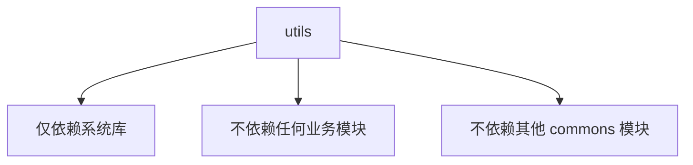

# Utils 工具模块使用规范

## 1. 跨模块导入标准

### 1.1 从其他模块导入 utils

```ets
// 方式一：导入整个模块（推荐）
import * as Utils from 'commons/utils';

Utils.Logger.info('应用启动');
Utils.DateUtil.format(new Date());

// 方式二：按需导入（推荐）
import { Logger, DateUtil } from 'commons/utils';

Logger.info('应用启动');
DateUtil.format(new Date());

// 方式三：从子模块导入
import { Logger } from 'commons/utils/log';
import { DateUtil } from 'commons/utils/date';
```

### 1.2 在 commons 内部模块导入

```ets
// network 模块使用 utils
import { Logger } from 'commons/utils/src/main/ets/log';
import { ValidationUtil } from 'commons/utils/src/main/ets/validation';

Logger.info('网络请求开始');
if (!ValidationUtil.isValidUrl(url)) {
  Logger.error('URL 格式错误');
}
```

### 1.3 在 HAP 包中导入

```ets
// phone 模块使用 utils
import { Logger, ResponsiveUtil } from 'commons/utils';

Logger.info('页面加载');
const cols = ResponsiveUtil.getGridCols();
```

---

## 2. 模块依赖约束

### 2.1 允许引用 utils 的模块

| 模块类型 | 是否允许 | 说明 |
|---------|---------|------|
| commons/* | ✅ | 所有 commons 子模块均可引用 |
| features/* | ✅ | 所有 features 功能模块均可引用 |
| product/* | ✅ | 产品变体模块可引用 |
| oh_modules | ❌ | 第三方库不允许引用 |

### 2.2 utils 的依赖限制



**约束规则：**
1. ✅ 可依赖：`@kit.*` 系统能力、`oh_modules` 第三方库
2. ❌ 禁止依赖：`commons/network`、`commons/datastore`、`features/*` 等

### 2.3 循环依赖检测

```ets
// ❌ 错误示例：utils 引用 datastore
// commons/utils/src/main/ets/storage/StorageUtil.ets
import { PreferencesUtil } from 'commons/datastore/src/main/ets/PreferencesUtil';

// ✅ 正确做法：让业务层组合使用
// 在业务模块中同时导入 utils 和 datastore
import { StorageUtil } from 'commons/utils';  // 纯工具逻辑
import { PreferencesUtil } from 'commons/datastore';  // 持久化逻辑
```

---

## 3. 新增工具类规范

### 3.1 分类存放指南

| 功能分类 | 存放目录 | 说明 | 示例 |
|---------|---------|------|------|
| 日志输出 | `log/` | 日志、性能追踪 | Logger、PerformanceMonitor |
| 时间处理 | `date/` | 日期、时间、定时器 | DateUtil、TimerUtil |
| 数据验证 | `validation/` | 格式校验、数据清洗 | ValidationUtil、SanitizeUtil |
| 字符串处理 | `validation/` | 字符串操作（与验证关系密切） | StringUtil |
| 数据转换 | `convert/` | 类型、编码、序列化 | ConvertUtil、EncodeUtil |
| 集合处理 | `collection/` | 数组、对象、Map 操作 | ArrayUtil、ObjectUtil |
| 数学计算 | `math/` | 数值运算、随机数 | MathUtil、RandomUtil |
| 加密安全 | `crypto/` | 加密、解密、签名 | CryptoUtil、HashUtil |
| 网络工具 | `network/` | URL解析、协议处理 | UrlUtil（业务网络请求放 commons/network） |
| 设备信息 | `device/` | 硬件、系统、电池 | DeviceUtil、BatteryUtil |
| 布局适配 | `layout/` | 响应式、屏幕适配 | ResponsiveUtil、SafeAreaUtil |
| 文件操作 | `file/` | 文件路径、I/O辅助 | PathUtil（文件操作放 commons/file） |
| 图像处理 | `image/` | 图片压缩、格式转换 | ImageUtil、ColorUtil |

### 3.2 新增工具类模板

```ets
/**
 * [功能描述]工具类
 *
 * @module utils/[目录名]
 */
export class XxxUtil {
  // 私有构造函数，防止实例化
  private constructor() {}

  /**
   * 方法功能描述
   * @param param 参数说明
   * @returns 返回值说明
   */
  static xxxMethod(param: Type): ReturnType {
    // 实现
  }
}

// 导出相关类型/枚举
export enum XxxEnum {}
export interface XxxInterface {}
```

### 3.3 命名规范

| 类型 | 命名规则 | 示例 |
|------|---------|------|
| 类名 | `XxxUtil` | `StringUtil`、`CryptoUtil` |
| 方法名 | `camelCase` | `format()`、`isValidPhone()` |
| 常量 | `UPPER_SNAKE_CASE` | `DEFAULT_TIMEOUT` |
| 接口 | `PascalCase` 可加 `I` 前缀 | `DeviceConfig` 或 `IDeviceConfig` |
| 枚举 | `PascalCase` | `LogLevel` |

### 3.4 代码质量要求

1. **纯函数优先**：工具方法应为纯函数，无副作用
2. **参数校验**：对外暴露的方法必须进行参数校验
3. **类型安全**：明确参数和返回值类型
4. **文档注释**：公开方法必须有 JSDoc 注释
5. **单测覆盖**：核心工具方法必须有单元测试

```ets
// ✅ 良好示例
static isValidPhone(phone: string): boolean {
  if (!phone) return false;  // 参数校验
  const reg = /^1[3-9]\d{9}$/;
  return reg.test(phone);    // 纯函数
}

// ❌ 不良示例
static isValidPhone(phone: string): boolean {
  // 无参数校验
  return /^1[3-9]\d{9}$/.test(phone);
}
```

---

## 4. 版本变更记录

| 版本 | 日期 | 变更内容 |
|------|------|---------|
| 1.0.0 | 2025-01-12 | 初始版本，包含 log/date/validation/device/layout 模块 |
